# Window Condensation Monitor

An Arduino Uno device that measures room-air temperature, glass-surface temperature and humidity, calculates the dew point, and warns when a window is about to fog. I built it, calibrated its sensors, and tested its predictions against real condensation in five ice-water trials.

**Short version of what I found:** the alert logic matches the dew-point formula exactly, and heavy fog formed within 0.7 °C of the predicted dew point in four of five trials. First haze appeared earlier than predicted, by 1.1 to 4.4 °C, and I could not explain why. The 3 °C early-warning margin only gave advance notice in 2 of 5 trials.

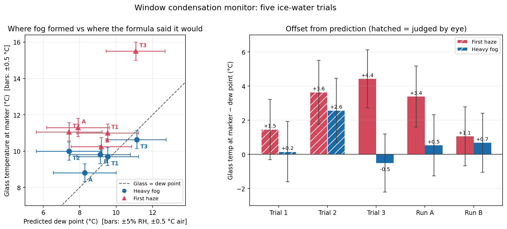

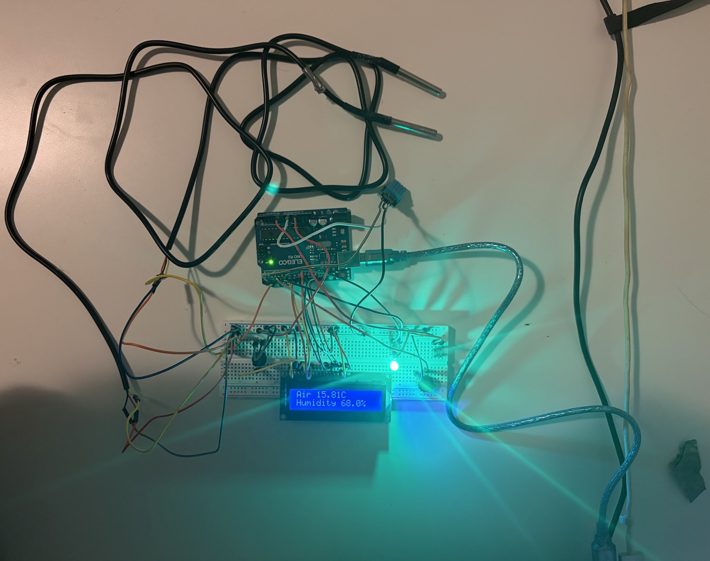

---

## What it does

- Reads **air temperature** (DS18B20 probe), **glass temperature** (second DS18B20 probe, taped to the glass) and **relative humidity** (DHT11).
- Calculates the **dew point** from air temperature and humidity (Magnus formula):
  `γ = ln(RH/100) + 17.62·T / (243.12 + T)`, then `dew point = 243.12·γ / (17.62 − γ)`
- Computes the **margin** = glass temperature − dew point, and reports a status:

| Margin | Status | LED | Buzzer |
|---|---|---|---|
| more than 3 °C | SAFE | green | off |
| 0 to 3 °C | WARNING | yellow | off |
| 0 °C or below | CONDENSING | red | beeping |
| a probe is not responding | SENSOR ERROR | red, blinking | off |

- Shows readings on a 16x2 LCD, three pages selected with a button.
- Prints every reading to the Serial Monitor for logging.
- If a probe disconnects, it keeps the last good value for two readings, then shows an error. A bad reading never triggers the alarm.

## The three LCD pages and the alerts

| Page 0: air and humidity | Page 1: glass and dew point | Page 2: margin and status |
|---|---|---|
| 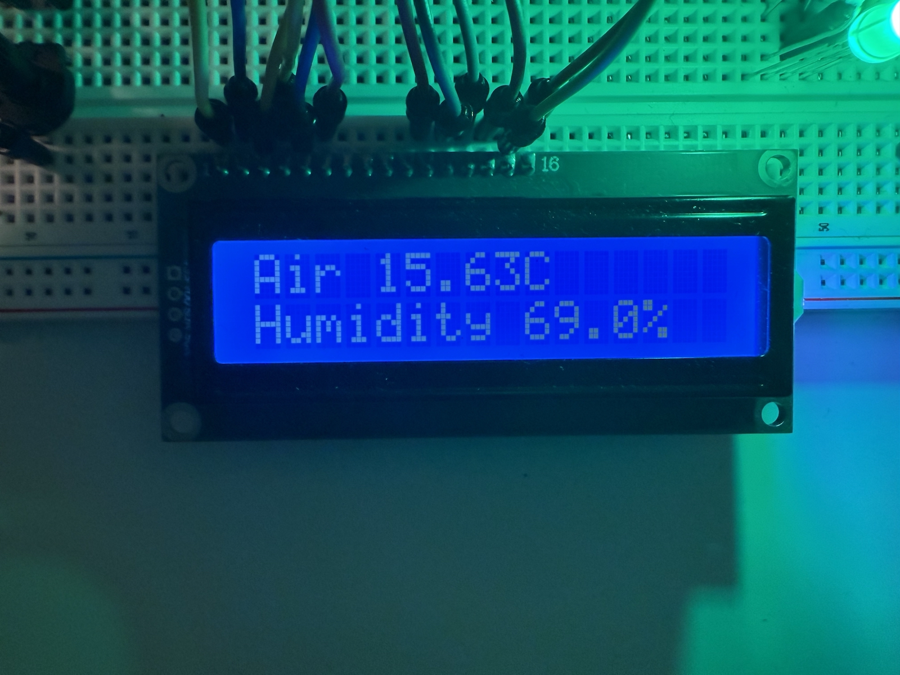 | 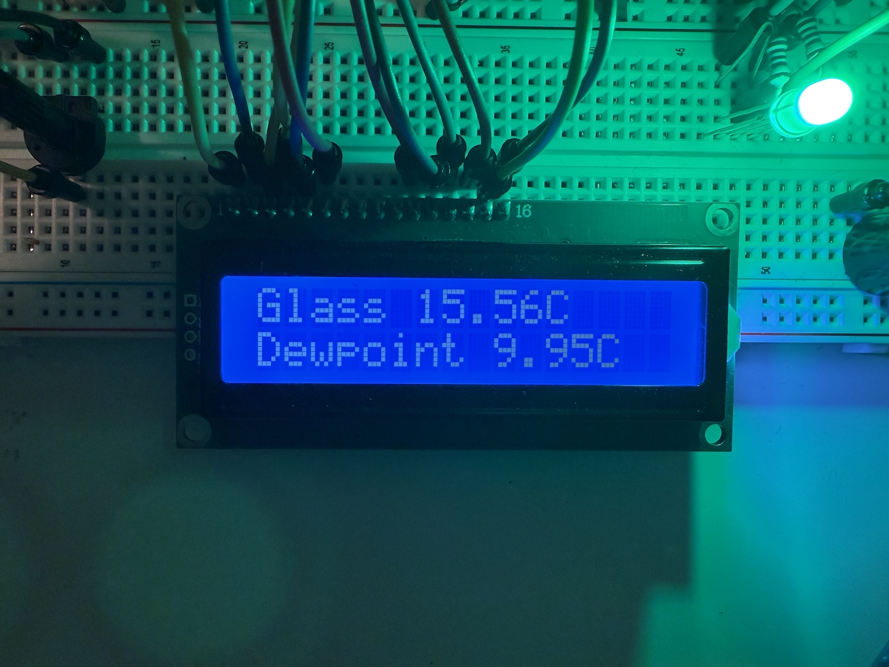 | 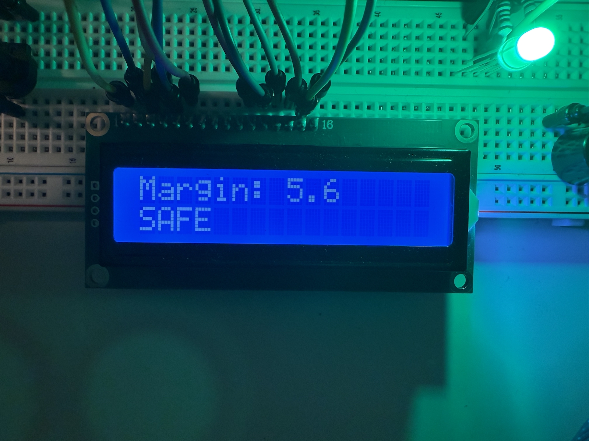 |

| SAFE | WARNING | CONDENSING |
|---|---|---|
| 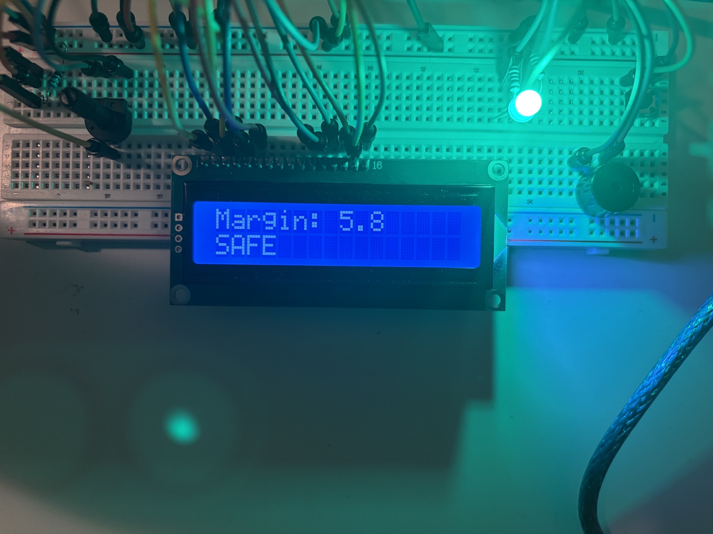 | 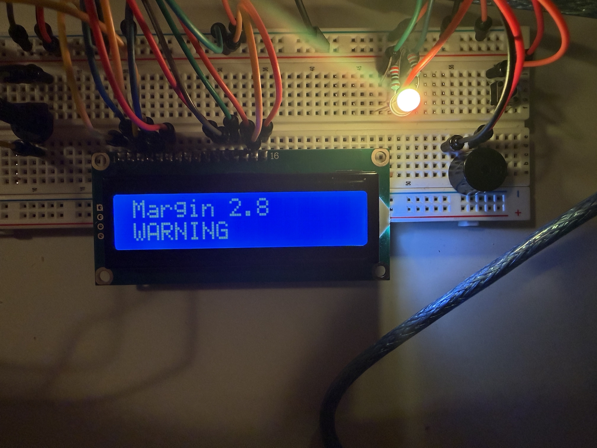 | 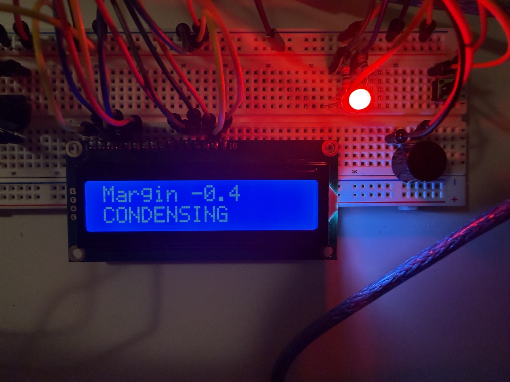 |

## Hardware

| Part | Pin |
|---|---|
| DHT11 (humidity) | 2 |
| DS18B20 probes x2, shared 1-Wire bus, 4.7 kΩ pull-up | 3 |
| Active buzzer | 4 |
| RGB LED, red / green (blue unused), 220 Ω resistors | 5 / 6 |
| Page button (`INPUT_PULLUP`) | A0 |
| LCD 1602 (RS, E, D4 to D7) | 7, 8, 9, 10, 11, 12 |

Arduino Uno R3, breadboard, 10 kΩ contrast potentiometer, digital multimeter for checks.
Libraries: OneWire, DallasTemperature, LiquidCrystal, `dht_nonblocking`.

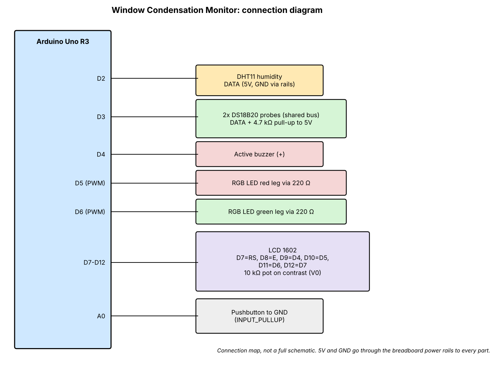

The diagram is a connection map, not a full schematic. 5V and GND run through the breadboard power rails to every part.

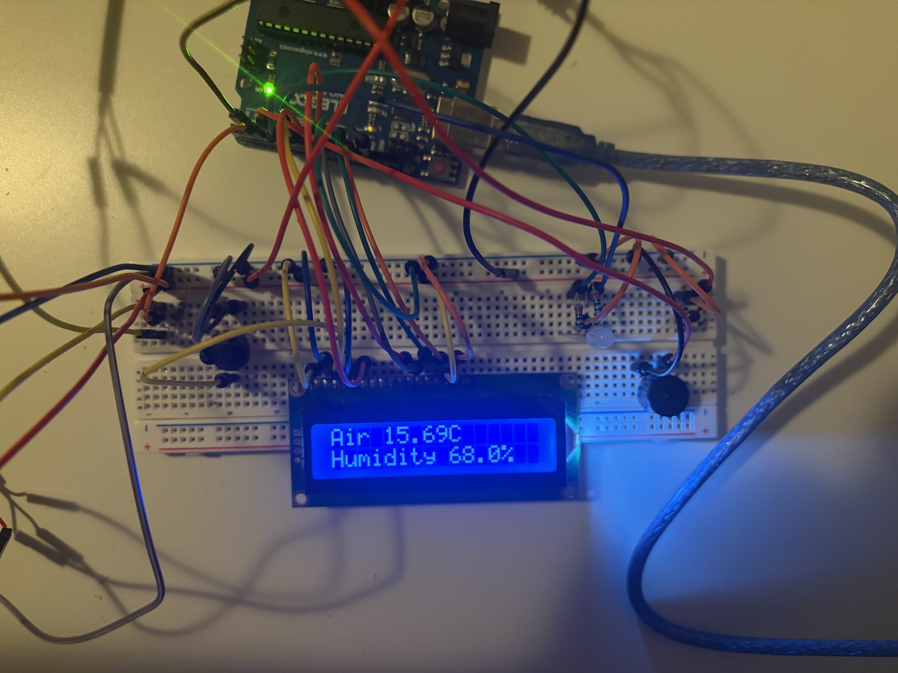

## Calibration

| Test | Result |
|---|---|
| **Ice bath** (DS18B20, about 8 min) | Settled between −0.25 and −0.44 °C for most of the run, minimum −0.69 °C, last readings −0.06 to 0.00 °C. Freezer ice starts below 0 °C, so the early dip is probably the bath. Within the sensor's ±0.5 °C specification, so no correction applied. |
| **Two probes side by side**, room air, about 45 readings | Agreed within about 0.06 to 0.13 °C (18.56 to 18.62 vs 18.69 °C). |
| **DHT11 vs probes**, same air | The DHT11 read a steady 22.0 °C while the probes read about 18.6 °C, a **3.4 °C offset**, and it only reports whole degrees. I used the probes for all temperatures and the DHT11 for humidity only. |
| **Salt-solution humidity check**, about 7 hours | The DHT11 settled at about **75% RH** over saturated salt solution (about 75% RH reference). It is accurate at that point. It was not tested at the 55 to 66% range used in the trials. |

## Validation method

I cooled a glass of water with ice (in a bag, so it never touched the wall) while the glass probe was taped flat to the outside wall below the waterline, under foam. The air probe and DHT11 sat 10 to 30 cm away. I recorded the glass temperature at four moments: first haze, light fog, heavy fog, and the status changes. Dew point was taken from the device at that moment.

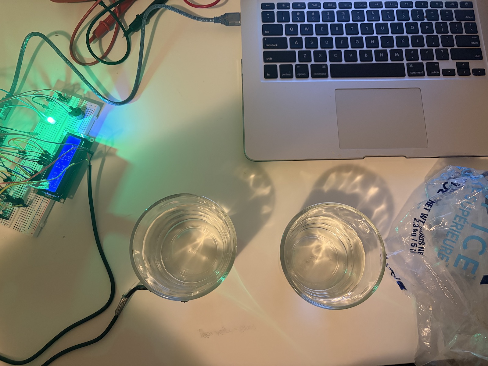

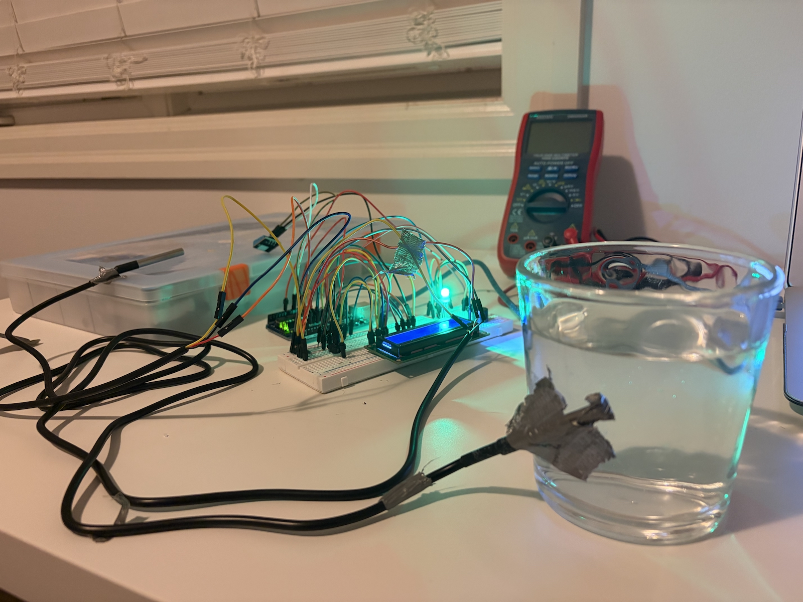

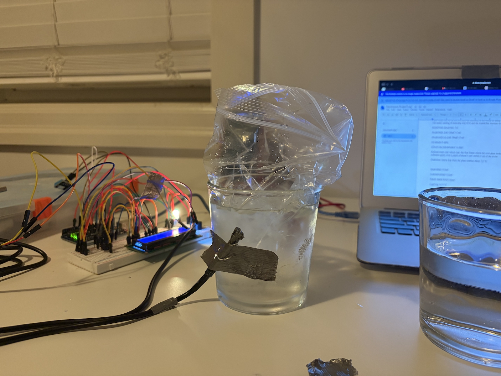

The protocol got stricter as I went:

| Run | How fog was judged |
|---|---|
| Trials 1 and 2 | By eye, while I could see the dew point on the display |
| Trial 3, Run A | Compared with a dry reference glass in the same frame |
| Run B | Reference glass, plus a second person who could not see the temperature |

Run B was also cooled in steps. The temperature was still falling when I removed the ice, so these were not true holds.

## Results

Offset = glass temperature at the marker − dew point at that moment. A perfect prediction is 0.

| Run | Judged by | Air / RH | Dew point | First haze | Offset | Heavy fog | Offset |
|---|---|---|---|---|---|---|---|
| Trial 1 | eye | 17.1 °C / 61% | 9.54 | 11.00 | +1.5 | 9.70 | +0.2 |
| Trial 2 | eye | 16.5 °C / 55% | 7.42 | 11.06 | +3.6 | 10.00 | +2.6 |
| Trial 3 | reference glass | 17.6 °C / 66% | 11.13 | 15.50 | +4.4 | 10.63 | −0.5 |
| Run A | reference glass | 16.3 °C / 59% | 8.28 | 11.30 | +3.4 | 8.81 | +0.5 |
| Run B | reference + blind reader | 16.2 °C / 63% | 9.13 | 10.25 | +1.1 | 9.81 | +0.7 |

- **Alert logic:** WARNING fired at a margin just under 3 °C and CONDENSING at about 0 °C in every run, matching the formula.
- **Heavy fog** was within 0.7 °C of the dew point in four of five runs. Trial 2, the loosest protocol, missed by 2.6 °C.
- **First haze** was 1.1 to 4.4 °C above the dew point.
- **Early warning:** the 3 °C warning came before first haze only in Trial 1 and Run B. In Trial 2, Trial 3 and Run A, haze appeared before or at the warning.
- **Flicker:** near the dew point, the status flipped between WARNING and CONDENSING in Run B, because the humidity reading moved between 62% and 63% and one point of humidity moves the dew point by about 0.2 to 0.25 °C.

## Error analysis

The dew point depends on the DHT11's humidity (specified ±5% RH) and on the air probe (±0.5 °C). The offset also depends on the glass probe (±0.5 °C).

**Worked example, Run B** (air 16.19 °C, 63% RH, dew point 9.13 °C):

1. Humidity ±5 points alone: dew point 7.91 to 10.27 °C (±1.2 °C).
2. Adding air temperature ±0.5 °C: dew point 7.44 to 10.75 °C (±1.65 °C).
3. Adding glass probe ±0.5 °C in quadrature: √(1.65² + 0.5²) ≈ **±1.7 °C** on the offset.

Run B's offsets (+1.1 first haze, +0.7 heavy fog) are inside that range.

| Run | Offset uncertainty | Heavy fog inside it? | First haze inside it? |
|---|---|---|---|
| Trial 1 | ±1.8 | yes (+0.2) | yes (+1.5) |
| Trial 2 | ±1.9 | **no** (+2.6) | **no** (+3.6) |
| Trial 3 | ±1.7 | yes (−0.5) | **no** (+4.4) |
| Run A | ±1.8 | yes (+0.5) | **no** (+3.4) |
| Run B | ±1.7 | yes (+0.7) | yes (+1.1) |

Heavy fog agrees with the prediction within sensor uncertainty in four of five runs. First haze does in two of five, so sensor error alone does not explain the early haze in Trials 2 and 3 and Run A. The salt test also makes a large humidity error unlikely, at least near 75%.

## The early haze: what I tested

Hypothesis: the glass probe lags the wall during cooling, so it reads warmer than the glass really is. If so, the offset should be roughly (cooling rate) × (lag time). I computed the cooling rate at haze from the Serial logs (one line about every 3 seconds):

- Trials 1 to 3 gave an implied lag of 0.9 to 1.9 minutes.
- Using about 1.4 minutes, Run B was predicted well (+1.1 predicted, +1.1 measured).
- **Run A failed.** It was cooling slowly (about 0.5 °C/min), which predicts a small offset, but its first haze was +3.4 °C.

I do not consider lag supported. Other candidates I could not separate: an uneven wall temperature (fog starts at the coldest patch, and the probe reads one spot), and how I judged haze. **The cause of the early haze is unresolved.**

## What went wrong along the way

- **Expectation bias.** In Trials 1 and 2 I knew the dew point while judging fog. Trial 1's result contradicted what I expected, and that is how I noticed. I added the reference glass and blind reader for later runs.
- **A prediction I wrote wrong.** My Trial 3 prediction said 7.5 °C, which was Trial 2's number carried over. The formula gave about 11.1 °C, and heavy fog matched that. I kept the original note and added a correction.
- **No blind check on Trial 3 or Run A.** For Run A I had predicted +3 to +4 °C beforehand and called haze at +3.4, so expectation may have shaped that call.
- **Coding bugs** that taught me to check my own assumptions: `=` instead of `==` in five places (including a screen redraw check that ran on every pass), reading a variable on loops where nothing had assigned it, a `pinMode` where I meant `digitalWrite`, and a function written inside another function.
- **Hardware faults:** a power/ground short on the breadboard, a wire whose bare metal was too short to reach the contact (the probe read −127 °C until I stripped more insulation), and a button installed a quarter turn wrong.
- **Both probes returned −127 at the same time for about 15 seconds during Run B.** The fault handling worked: error shown, no false alarm, automatic recovery. Both failing together points to a loose shared connection.

## Limitations

- Trials 1 and 2 were judged by eye and are less reliable. Only Run B had a blind reader.
- Only one slowly cooled run exists.
- Humidity accuracy was checked at one point (75% RH). The trials ran at 55 to 66%.
- The probe measures one spot on the glass, through foam, not the coldest patch.
- Humidity differed between Run A (59%) and Run B (63%).
- Run B's haze and heavy-fog temperatures come from my hold notes. The Serial log shows the glass still cooling during them.
- Everything was tested in a room with ice water, not on a window overnight.
- The Arduino libraries were updated on October 31, 2026, after Trials 1 to 3 and before Run A and Run B. The two probes still agreed afterward.

## Conclusion and what I would change

The dew-point calculation predicts heavy condensation well, within sensor uncertainty. First haze comes earlier, and my data do not say why. A margin of about 5 °C would have fired before first haze in all five runs, but I have not tested it, and some haze calls were not blind. I did not implement hysteresis, which would stop the status flickering near the threshold.

Next steps: test a larger warning margin, add hysteresis, put a second probe lower on the glass to check for an uneven wall, and log a real window overnight.

## Files

```
condensation-monitor/
  README.md
  images/
    fig_results.png            results figure
    wiring_diagram.png         connection diagram
  photos/                      photos of the build and the tests
  code/condensation_monitor/
    condensation_monitor.ino   final sketch
    dht_nonblocking.h / .cpp   DHT11 library files from the Elegoo UNO kit tutorial (see below)
  data/
    trial1_serial_log.txt      raw Serial Monitor output, one line about every 3 s
    trial2_serial_log.txt
    trial3_serial_log.txt
    runA_serial_log.txt
    runB_serial_log.txt
    calibration_ice_bath_and_dht_comparison.txt
    calibration_two_probes_room_air.txt
```

## How to run it

1. Wire the parts as in the table and diagram above.
2. In the Arduino IDE, install **OneWire** and **DallasTemperature** from the Library Manager. **LiquidCrystal** is built in.
3. Put `dht_nonblocking.h` and `dht_nonblocking.cpp` (from the Elegoo UNO kit tutorial files) in the same folder as `condensation_monitor.ino`. They are Elegoo's files, so they are not included here.
4. Upload, open the Serial Monitor at 9600 baud, and press the button to cycle the LCD pages.

## Data notes

- Run B's log was pasted twice when I saved it; the repeated copy is removed here. Nothing else was edited.
- Serial lines read `raw Glass`, `raw Air` (raw probe values, -127.00 means no response), humidity in %RH, the last good probe values, dew point, margin and status. `REDRAW` marks an LCD refresh, and `Page:` marks a button press.
